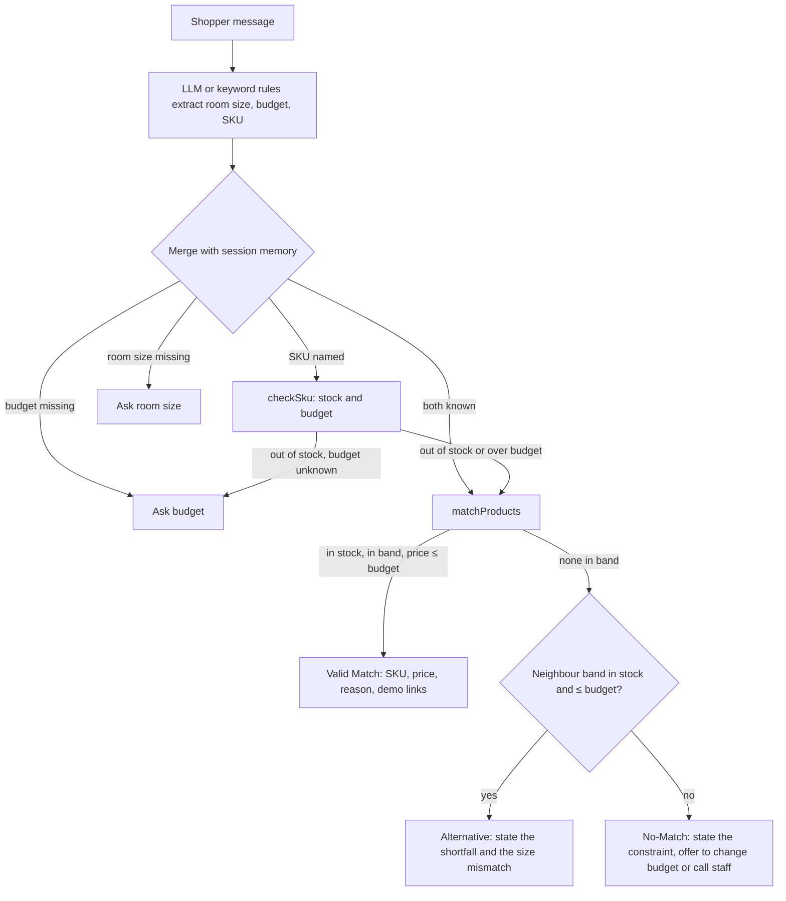
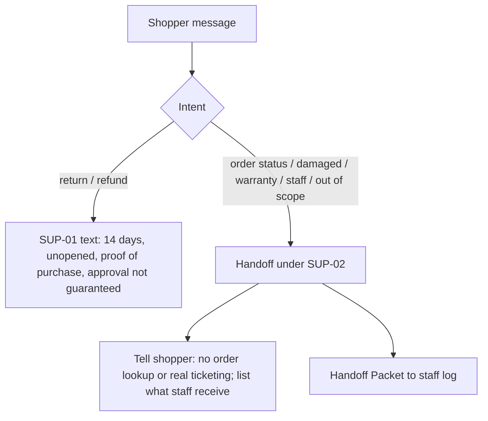
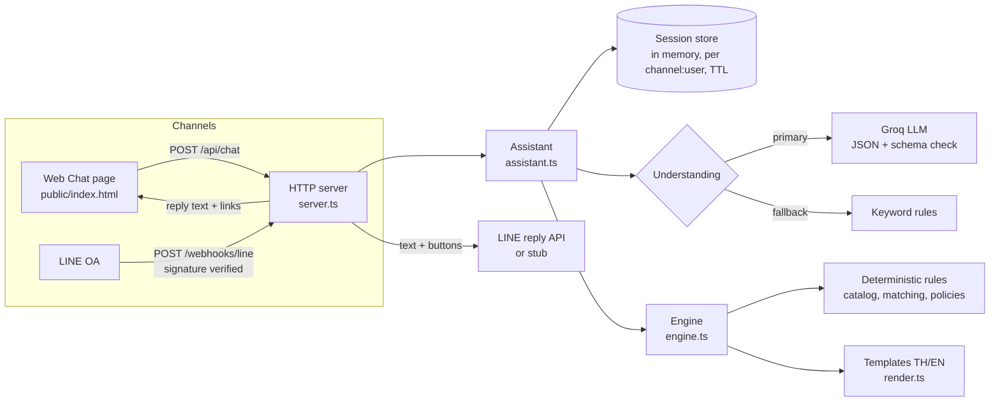

# HomePro AI Assistant (pilot demo)

A sales and customer-service chat assistant for a fictional fan catalog. It runs on Web Chat and LINE Official Account. Both channels call one shared backend, so they apply the same catalog, policy and handoff rules.

The LLM (Groq) only reads the shopper's message. It extracts intent, room size, budget, SKU and language as JSON. Code decides and writes every SKU, price, stock statement, policy text and handoff notice. See [ADR 0001](docs/adr/0001-llm-for-understanding-only.md). Terms such as Valid Match, Alternative and Handoff Packet are defined in [GLOSSARY.md](GLOSSARY.md).

All data is fictional. There are no payments, no real orders and no real tickets.

## Quick start

Requirements: Node.js 24 or later. No build step is needed, because Node runs the TypeScript directly.

```sh
npm install
cp .env.example .env        # optional: add GROQ_API_KEY and LINE credentials
npm test                    # typecheck + 71 unit, flow and HTTP tests
npm run scenarios           # the 6 spec scenarios; writes docs/test-results.md
npm start                   # http://localhost:3000
```

The server runs without a `.env` file. In that case it uses the keyword rules instead of the LLM, and the LINE webhook is off. The startup log line states which mode is active.

| Variable | Purpose |
| :-- | :-- |
| `PORT`, `PUBLIC_BASE_URL` | Listen port, and the base URL used in demo product and checkout links |
| `GROQ_API_KEY`, `GROQ_MODEL`, `LLM_TIMEOUT_MS` | LLM understanding. Leave the key empty to use keyword rules only |
| `LINE_CHANNEL_SECRET` | Turns on `POST /webhooks/line` and verifies `X-Line-Signature` |
| `LINE_CHANNEL_ACCESS_TOKEN`, `LINE_MODE` | `LINE_MODE=stub` captures replies. Any other value sends them through the LINE reply API |
| `SESSION_TTL_MINUTES` | Idle session lifetime |

### Running the LLM scenarios

```sh
npm run scenarios -- --llm   # same 6 scenarios with Groq; writes docs/test-results-llm.md
```

### Connecting LINE live

1. In the LINE Developers console, create a Messaging API channel. Copy the channel secret and a long-lived channel access token into `.env`, and set `LINE_MODE=live`.
2. Expose the server over HTTPS, for example with `ngrok http 3000`. Set `PUBLIC_BASE_URL` to the HTTPS URL.
3. Set the webhook URL to `<PUBLIC_BASE_URL>/webhooks/line`, turn on **Use webhook**, and turn off the auto-reply messages.
4. Message the OA from the LINE app.

Fallback verification (spec §3.2): `npm run scenarios` signs synthetic LINE webhook events with a test secret. It posts them to the real webhook endpoint and captures the reply payload through a stub reply client. **This repository's recorded results use the stub, so live LINE delivery is unverified** until steps 1 to 4 are run with real credentials.

## Flow design

### Decision boundaries

| Situation | Assistant does |
| :-- | :-- |
| Sales intent, room size or budget missing | **Ask**, and only for the slot that is missing |
| Room size and budget both known | **Answer** with a Valid Match, an Alternative, or a No-Match |
| A specific SKU is asked about | **Answer** with its stock and budget fit. If it is out of stock or over budget, offer an Alternative (or ask for the budget first) |
| Return or refund question | **Answer** from `SUP-01` only |
| Order status, damaged delivery, warranty, shopper asks for staff, or the LLM judges the question out of scope | **Hand off** under `SUP-02` |
| LLM down or invalid, and the keyword rules can't read the message | Safe **fallback** message listing what the assistant can do |

### Sales flow (Flow A)



Matching rules: only products with `stock > 0` and `price ≤ budget` are ever offered. An Alternative comes from the next band only (larger first, then smaller), never two bands away. Room bands are Small (≤ 15 m²), Medium (16 to 25 m²) and Large (> 25 m²).

**Success criteria (Flow A):** every recommended SKU is in stock and within the stated budget, for 100% of replies (enforced in code and tested over a grid of bands and budgets). A slot the shopper has already given is never asked again. Every recommendation names its SKU, price and reason, and carries a demo product link and a demo checkout link.

### Service flow (Flow B)



**Success criteria (Flow B):** 100% of return answers contain the `SUP-01` conditions and no approval promise. 100% of handoffs state that no order lookup or ticketing exists, and no reply contains an invented order status or ticket ID. The internal `handoffId` is never shown to the shopper.

## System architecture



| Path | Responsibility |
| :-- | :-- |
| `packages/shared` | Types shared by the backend and channels (`AssistantReply`, `HandoffPacket`, and others) |
| `apps/api/src/domain` | Fixtures and pure rules: catalog, room bands, matching, SKU checks, policy records |
| `apps/api/src/conversation` | Understanding (schema and keyword rules), session store, engine, reply templates |
| `apps/api/src/llm/groq.ts` | Groq call. Throws on any failure so the caller can fall back |
| `apps/api/src/channels/line.ts` | LINE signature check, event parsing, message formatting, live and stub reply clients |
| `apps/api/src/server.ts` | HTTP routes, input validation, demo product and checkout pages |
| `apps/api/src/scenarios.ts` | The spec §6 scenarios, driven over HTTP against the real server |

Diagnostics: every request and turn is logged as one JSON line (`http`, `turn`, `llm_ok`, `llm_failed`, `handoff_packet`). Fields whose names look like credentials (`*token`, `*secret`, `apiKey`, `authorization`, `*signature`) are redacted.

## Handoff payload specification

When a handoff happens, the shopper sees the SUP-02 notice. Staff receive this packet, which is logged as the `handoff_packet` event and also returned in the API reply's `handoff` field.

| Field | Type | Meaning |
| :-- | :-- | :-- |
| `handoffId` | string (UUID) | Internal reference. Never shown to the shopper |
| `channel` | `"web"` \| `"line"` | Where the conversation happened |
| `sessionKey` | string | `channel:userId`, which identifies the conversation |
| `reason` | `order_status` \| `damaged_delivery` \| `uncovered_warranty` \| `shopper_request` \| `out_of_scope` | Why it was escalated |
| `policyRef` | `"SUP-02"` | Policy that governs the handoff |
| `shopperLanguage` | `"th"` \| `"en"` | Language to reply in |
| `knownContext` | `{ roomSizeBand?, budgetThb?, skusMentioned[] }` | What the shopper already told the assistant |
| `lastMessages` | `{ role, text, at }[]` | Up to the last 6 turns, ending with the message that triggered the handoff |
| `createdAt` | ISO 8601 | When the handoff happened |

```json
{
  "handoffId": "94a11e7b-2178-46fd-8cea-dd02fc868d7c",
  "channel": "web",
  "sessionKey": "web:web-test-1234",
  "reason": "order_status",
  "policyRef": "SUP-02",
  "shopperLanguage": "en",
  "knownContext": { "roomSizeBand": "small", "budgetThb": 1000, "skusMentioned": [] },
  "lastMessages": [
    { "role": "shopper", "text": "I need a fan for my 12 sqm bedroom", "at": "2026-11-22T10:56:51.353Z" },
    { "role": "assistant", "text": "Got it, a small room (up to 15 m²). What's your budget in THB?", "at": "2026-11-22T10:56:51.353Z" },
    { "role": "shopper", "text": "where is my order?", "at": "2026-11-22T10:56:51.471Z" }
  ],
  "createdAt": "2026-11-22T10:56:51.471Z"
}
```

## Testing

- `npm test` typechecks, then runs the unit, flow and HTTP tests: domain rules, the keyword understander, the engine, sessions, the LINE adapter, the Groq client against a fake API, and the six scenarios.
- `npm run scenarios` writes the spec §6 table (input, expected, observed, status, total passed, known limitation) to [docs/test-results.md](docs/test-results.md).

## Pilot metric

**Valid-link rate:** the share of sales sessions that reach a reply carrying a demo product link for an in-stock, within-budget SKU. Target: **≥ 70% of sales sessions during the pilot**. It is measured from `turn` log events. The numerator is sessions with `decision: "match"` or `"sku"` and a reply that has actions. The denominator is sessions with at least one `intent: "sales"` turn.

## Known limits

- Sessions live in process memory. A restart forgets every conversation, and more than one server instance would split a shopper's history.
- Without an LLM, the keyword rules recognise common English and Thai phrasings only. Anything they can't read gets the fallback message, not a handoff.
- Concurrent messages in the same session can overwrite each other's session update, because the last write wins.
- Live LINE delivery is unverified in the recorded results, which use the stub reply client.
- The checkout and product pages are demo placeholders. No order is created.

## AI disclosure

This code and documentation were written with an AI coding assistant (Claude Code, Anthropic). Its output was checked by the typecheck, by 71 automated tests that include every spec scenario over real HTTP, by `npm audit`, and by reading the actual reply text from a running server.
